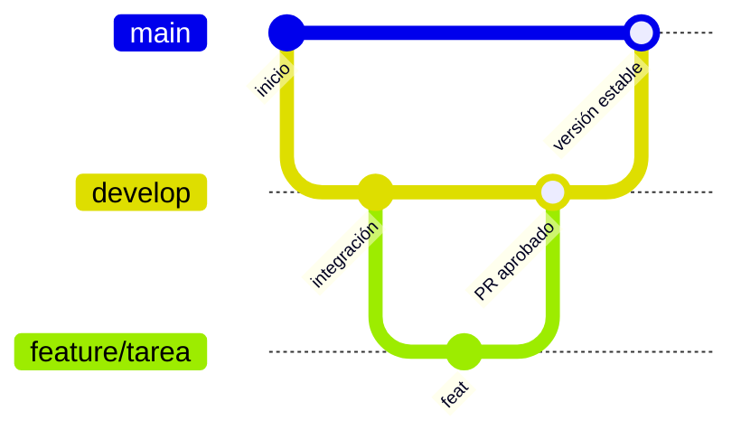

# Bitácora Digital · Excel → HTML5

**Migración de la plantilla de control de trabajo diario a un sitio web semántico y accesible**

---

## 🧭 Contenido

[Sobre el proyecto](#-sobre-el-proyecto) · [Equipo](#-equipo) · [Vistas](#-vistas-del-sitio) · [Accesibilidad](#-accesibilidad-y-semántica) · [Flujo Git](#-flujo-de-trabajo-git) · [Documentos](#-documentos-relacionados)

---

## 💡 Sobre el proyecto

> Actividad de apropiación y transferencia del programa **Tecnología en Análisis y Desarrollo de Software (ADSO)** del SENA.

Convertimos los libros y pestañas de la plantilla de control de trabajo diario en una **aplicación web estructurada**, que conserva la trazabilidad de la bitácora original y se puede consultar desde cualquier navegador.

| | |
|---|---|
| **Programa** | Tecnología en Análisis y Desarrollo de Software |
| **Institución** | SENA |
| **Ficha** | 3381732 |
| **Tecnología** | HTML5 semántico |

---

## 👥 Equipo

| | Integrante | Rol | GitHub |
|:---:|---|---|---|
|  | Nelson Yurfay Cuesta Ferrucho | 🏛️ Líder / Arquitecto | [@NelsonYurfayCuestaFerrucho](https://github.com/NelsonYurfayCuestaFerrucho) |
|  | Carlos Stiwen Rodriguez Cuesta | 💻 Desarrollador | [@carlosStiwen19](https://github.com/carlosStiwen19) |
|  | Juan David Esteban Carvajal Gualdrón | 💻 Desarrollador | [@JuanesGualdron](https://github.com/JuanesGualdron) |

---

## 🖥️ Vistas del sitio

Tres páginas independientes conectadas por un menú `<nav>` semántico:

| # | Archivo | Qué contiene |
|:-:|---|---|
| 1 | `index.html` | Información general: programa de formación, competencia, autor, ficha y periodo del sprint |
| 2 | `vista2.html` | Reglas y guía: responsabilidad única, prohibición de adjetivos subjetivos, inmutabilidad de registros y guía de llenado por columna |
| 3 | `vista3.html` | Trazabilidad: tabla de seguimiento diario con timestamps, objetos técnicos, evidencias de ejecución y planes de acción correctiva |

---

## ♿ Accesibilidad y semántica

**Etiquetas HTML5 utilizadas:** `header` · `nav` · `main` · `section` · `table` · `thead` · `tbody` · `footer`

- [x] `lang="es"` en la etiqueta raíz
- [x] Tablas con `<caption>` y `scope="col"` en los encabezados
- [x] `aria-current="page"` en el enlace de la vista activa
- [x] Un solo `<h1>` por vista y jerarquía de encabezados ordenada
- [x] Contraste de color suficiente
- [x] Navegación completa por teclado

---

## 🌿 Flujo de trabajo Git

| Rama | Propósito |
|---|---|
| `main` | Versión estable. **Sin push directo** |
| `develop` | Integración de funcionalidades |
| `feature/*` | Una rama por tarea, creada desde `develop` |

**Reglas:** todo cambio entra por Pull Request revisado por al menos un compañero, y los commits siguen Conventional Commits (`feat:`, `fix:`, `docs:`, `chore:`).

---

## 📎 Documentos relacionados

- 📜 [Acuerdo de trabajo del equipo](TEAM_AGREEMENT.md)

---

Hecho con dedicación por el equipo · SENA ADSO · Ficha 3381732

